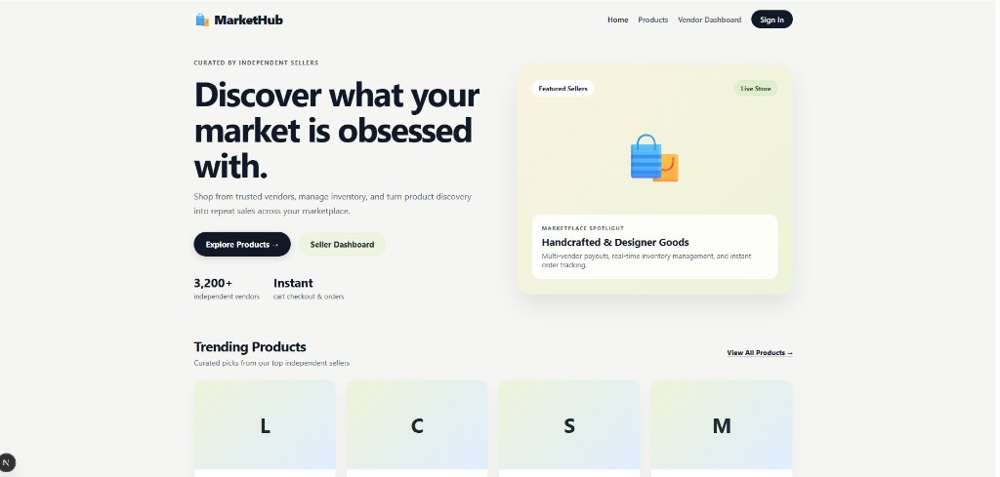
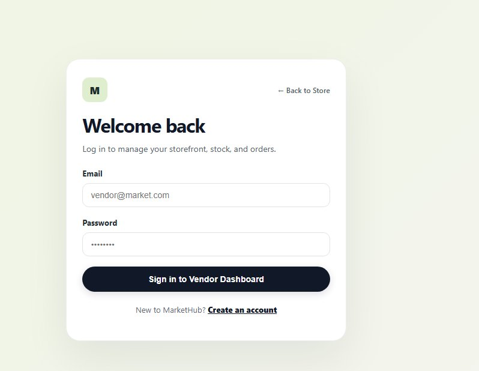
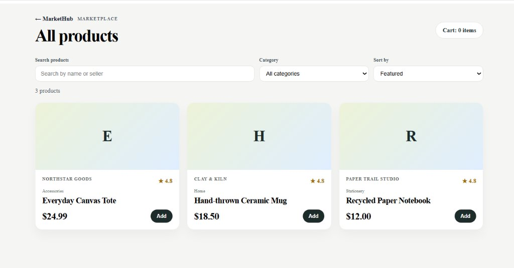
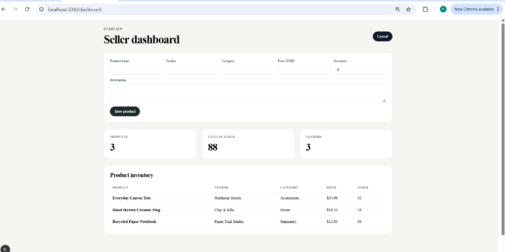

# FS-01: MarketHub — Multi-Vendor E-Commerce Marketplace

An Amazon-style marketplace where many vendors sell, customers buy, and the platform manages products, orders, and inventory.

## Screenshots

**Homepage**


**Login Page**


**Products Page**


**Seller Dashboard**


---

## How to Run Locally

Open two CMD windows:

**Window 1 — Start Backend:**
```cmd
cd backend
npm start
```
Backend runs on **http://localhost:4000**

**Window 2 — Start Frontend:**
```cmd
cd frontend
npm run dev
```
Frontend runs on **http://localhost:3000**

---

## Demo Login

- **Login URL:** http://localhost:3000/login
- **Email:** `vendor@market.com`
- **Password:** `password123`
- You can also create a new account at `/register`

---

## Features

- Browse products from multiple vendors on the storefront
- Search, filter by category, and sort by price or rating
- Add items to cart and complete checkout
- Vendor dashboard to manage product listings and inventory
- User registration with vendor or customer roles
- JWT-based authentication

---

## Tech Stack

- **Frontend:** React, Next.js, TypeScript, Tailwind CSS
- **Backend:** Node.js (HTTP server)
- **Auth:** JWT tokens, SHA-256 password hashing
- **Data:** In-memory store with pre-seeded demo products
