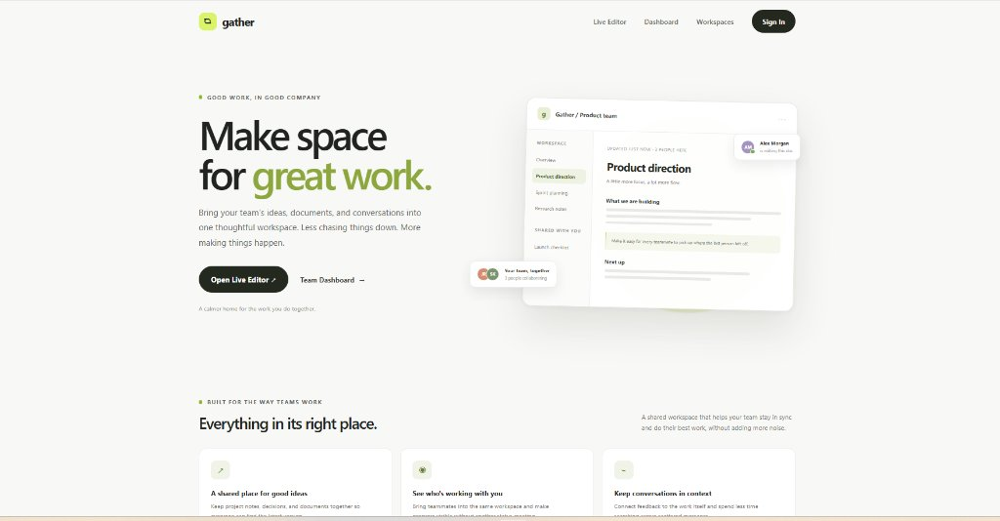
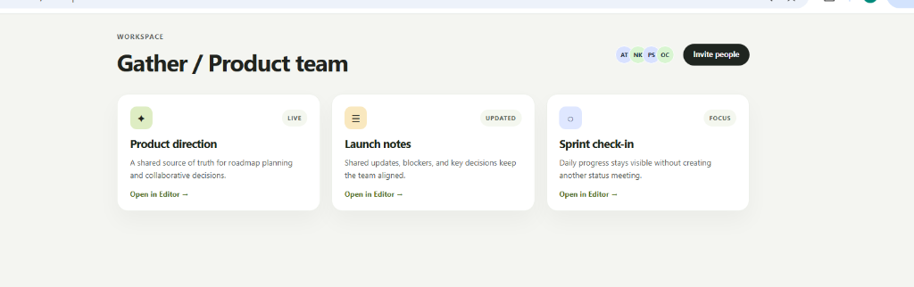
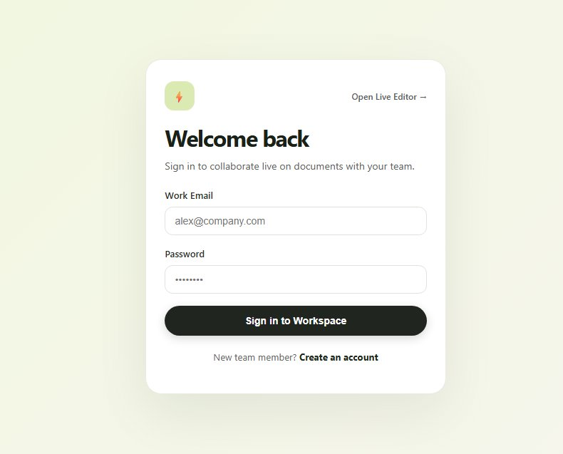
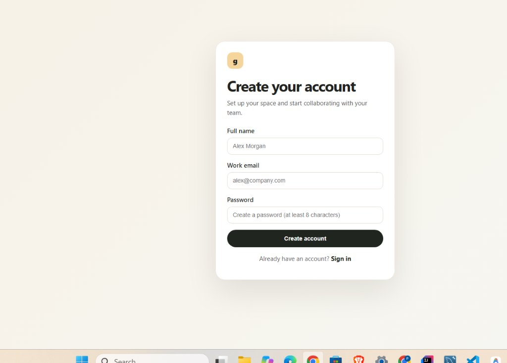

# FS-02: Gather — Real-Time Collaborative Workspace

A Notion/Figma-style workspace where several people edit the same document at once, see each other's cursors, and never lose changes.

## Screenshots

**Homepage**


**Workspace Dashboard**


**Login Page**


**Register Page**


---

## How to Run

Open two CMD windows:

**Window 1 — Start Backend:**
```cmd
cd backend
npm start
```
Backend runs on **http://localhost:5000**

**Window 2 — Start Frontend:**
```cmd
cd frontend
npm run dev
```
Frontend runs on **http://localhost:3001**

---

## Demo Login

* **Login URL:** http://localhost:3001/login
* **Email:** `alex@company.com`
* **Password:** `password123`
* You can also create a new account at `/register`

---

## Features

- Real-time collaborative rich text editor
- Live presence — see who else is online with colored cursors and avatars
- Workspace and document management
- Comment threads for team discussions
- Version history and document snapshots
- WebSocket-based live sync using Socket.io
- JWT-based authentication

---

## Tech Stack

- **Frontend:** React, Next.js, TypeScript, Tailwind CSS
- **Backend:** Node.js, Express, Socket.io
- **Auth:** JWT tokens, bcrypt password hashing
- **Real-time:** Socket.io WebSocket server
- **Database:** Prisma + PostgreSQL (with in-memory fallback)
