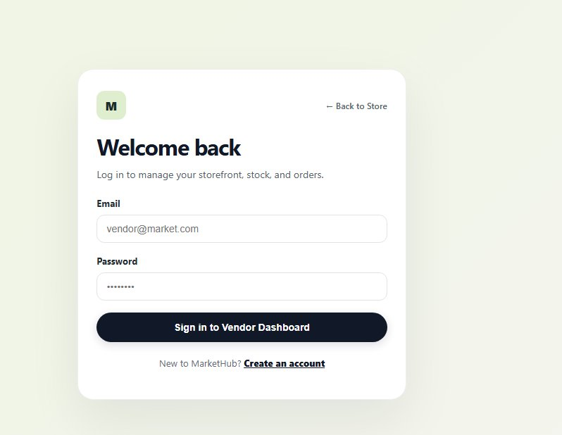
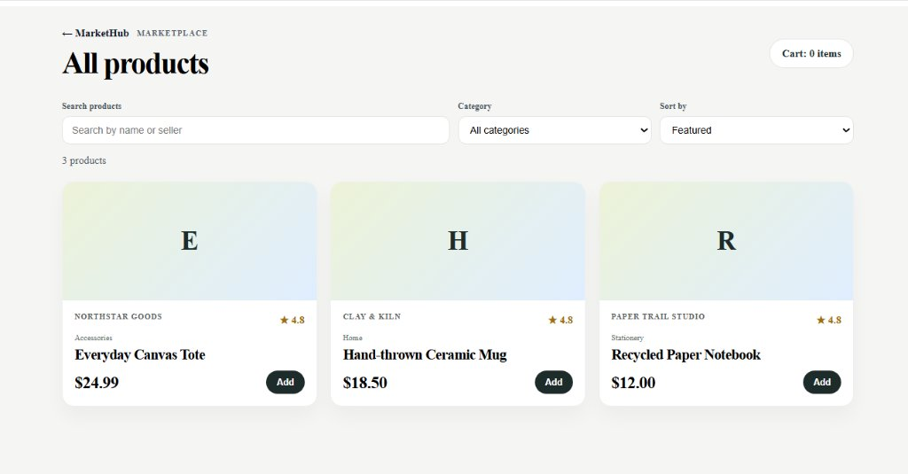
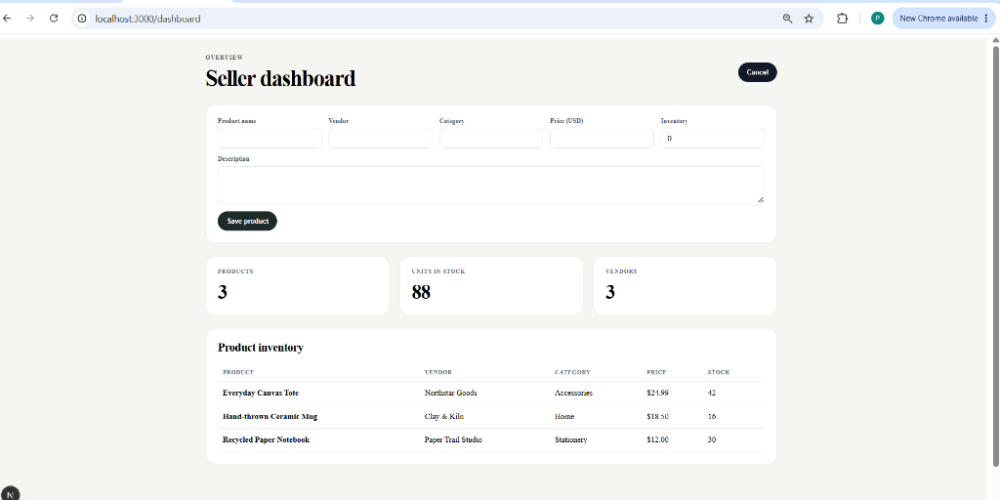
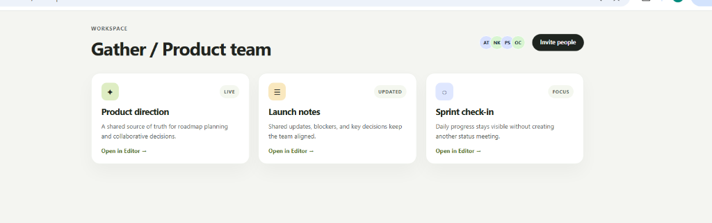

# Full-Stack Development Internship Projects

Welcome! This repository contains the source code for two complete full-stack web applications:

1. **Project #1 (FS-01): Multi-Vendor E-Commerce Marketplace**
2. **Project #2 (FS-02): Real-Time Collaborative Workspace**

When you open each project in your browser, it opens the **main website directly** (not a login gate), allowing you to explore the products, documents, and features immediately.

---

## 📸 Project Screenshots

### Project 1: MarketHub — Multi-Vendor E-Commerce Marketplace

**Homepage**


**Login Page**


**Products Page**


**Seller Dashboard**


---

### Project 2: Gather — Real-Time Collaborative Workspace

**Homepage**


**Workspace Dashboard**


**Login Page**


**Register Page**


---

## 🌐 Quick Access URLs

| Project | Website URL | Backend API |
| :--- | :--- | :--- |
| **Project 1: Multi-Vendor Marketplace** | **http://localhost:3000** | `http://localhost:4000` |
| **Project 2: Collaborative Workspace** | **http://localhost:3001** | `http://localhost:5000` |

---

## 💻 How to Run (CMD / Terminal)

Open **Command Prompt (CMD)** in the project directory:

### Option 1: Run Both Projects Together (Recommended)
Double-click **`run-all.bat`** or execute:
```cmd
run-all.bat
```
This automatically opens 4 separate windows for both backends and frontends.

---

### Option 2: Run Project 1 Only (Multi-Vendor Marketplace)
Double-click **`run-project-1.bat`** or run in two CMD windows:

**Window 1 (Backend):**
```cmd
cd FS-01-Multi-Vendor-Ecommerce\FS-01-Multi-Vendor-Ecommerce\backend
npm start
```

**Window 2 (Frontend):**
```cmd
cd FS-01-Multi-Vendor-Ecommerce\FS-01-Multi-Vendor-Ecommerce\frontend
npm run dev
```

* Main Storefront Website: **http://localhost:3000**
* Products & Cart: **http://localhost:3000/products**
* Vendor Dashboard: **http://localhost:3000/dashboard**

---

### Option 3: Run Project 2 Only (Collaborative Workspace)
Double-click **`run-project-2.bat`** or run in two CMD windows:

**Window 1 (Backend):**
```cmd
cd FS-02-Collaborative-Workspace\backend
npm start
```

**Window 2 (Frontend):**
```cmd
cd FS-02-Collaborative-Workspace\frontend
npm run dev
```

* Main Collaborative Website: **http://localhost:3001**
* Live Document Editor: **http://localhost:3001/document**
* Team Overview Dashboard: **http://localhost:3001/dashboard**
* Workspaces: **http://localhost:3001/workspace**

---

## 🔐 Demo Login Credentials (For Testing)

The user interfaces keep credentials clean and realistic (no passwords shown on-screen). You can test authentication using these pre-seeded demo accounts:

### Project 1 (MarketHub)
* **Login URL:** http://localhost:3000/login
* **Email:** `vendor@market.com`
* **Password:** `password123`
* *(You can also register any new customer or vendor account at `/register`)*

### Project 2 (Gather)
* **Login URL:** http://localhost:3001/login
* **Email:** `alex@company.com`
* **Password:** `password123`
* *(You can also register any new team member account at `/register`)*

---

## 🛠️ Tech Stack

| Technology | Used For |
| :--- | :--- |
| React + Next.js | Frontend UI |
| TypeScript | Type-safe code |
| Node.js + Express | Backend API |
| Tailwind CSS | Styling |
| Socket.io | Real-time sync (Project 2) |
| JWT | Authentication |
| Prisma + PostgreSQL | Database layer |

---

## 🌟 What You Can Test in Each App

### Project 1: Multi-Vendor Marketplace
- **Home & Catalog:** Browse curated items from independent sellers at `/products`.
- **Search & Filters:** Search products by keyword, category, and sort by price or rating.
- **Cart & Order Checkout:** Add items to your cart and click "Checkout Now" to place an order in real-time.
- **Vendor Dashboard:** Log in as a vendor to add listings, update stock levels, and review inventory.

### Project 2: Real-Time Collaborative Workspace
- **Main Landing Page:** Learn about workspace features and navigate directly to live tools.
- **Live Collaborative Editor:** Write and format documents live in Markdown at `/document`.
- **Team Discussion:** Post real-time comments and review active threads with colleagues.
- **Presence & Avatars:** See active team members collaborating on the same document.
