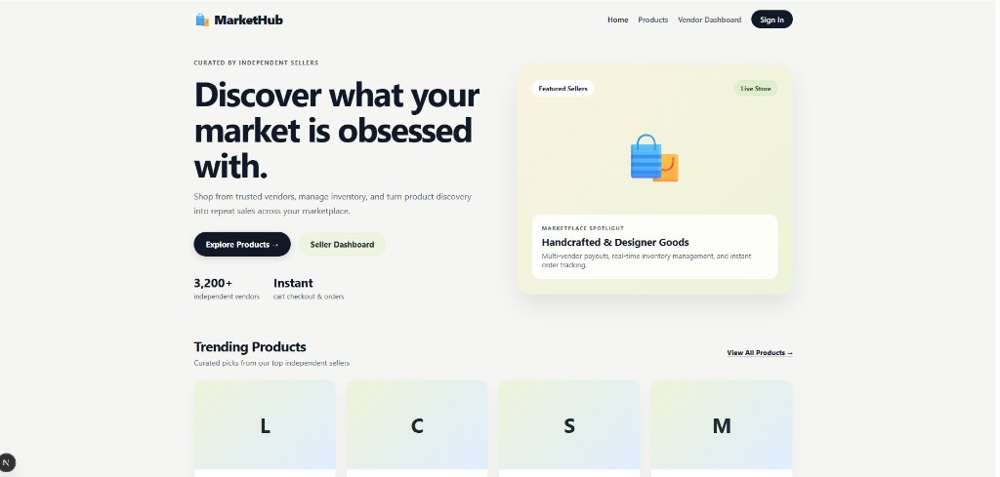
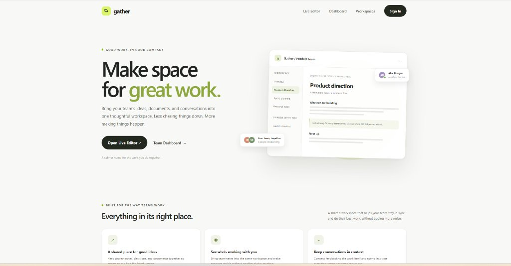
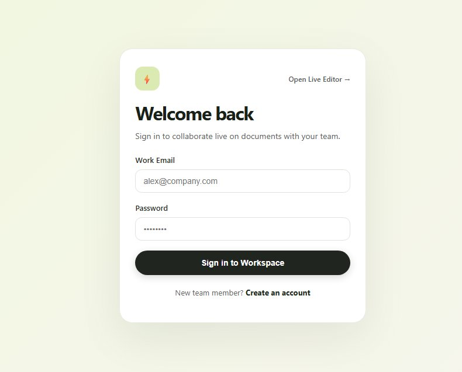
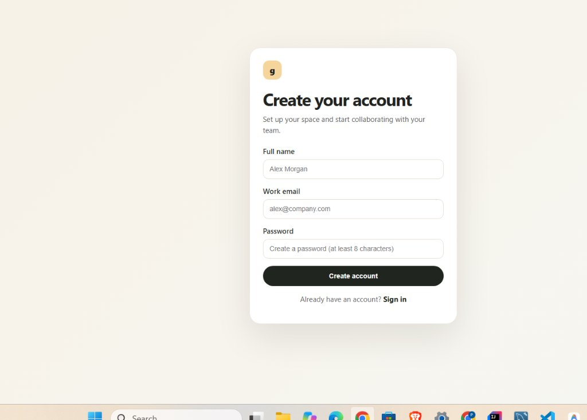

# Full-Stack Development Internship Projects

Welcome! This repository contains two complete full-stack web applications built as part of the internship program.

1. **Project 1 — FS-01: MarketHub (Multi-Vendor E-Commerce Marketplace)**
2. **Project 2 — FS-02: Gather (Real-Time Collaborative Workspace)**

---

## 🚀 Live Deployment

| Project | Live URL |
| :--- | :--- |
| **Project 1: MarketHub (Multi-Vendor Marketplace)** | 👉 **https://full-stack-development-internship-p.vercel.app** |
| **Project 2: Gather (Collaborative Workspace)** | 👉 **https://gather-workspace-psi.vercel.app** |

---

## 📸 Project Screenshots

### Project 1 — MarketHub: Multi-Vendor E-Commerce Marketplace

**Homepage**


**Login Page**


**Products Page**


**Seller Dashboard**


---

### Project 2 — Gather: Real-Time Collaborative Workspace

**Homepage**


**Workspace Dashboard**


**Login Page**


**Register Page**


---

## 💻 How to Run Locally (CMD)

### Run Both Projects Together
Double-click **`run-all.bat`** — it opens all 4 services automatically.

---

### Run Project 1 Only (MarketHub)
Open two CMD windows:

**Window 1 — Backend:**
```cmd
cd FS-01-Multi-Vendor-Ecommerce\backend
npm start
```

**Window 2 — Frontend:**
```cmd
cd FS-01-Multi-Vendor-Ecommerce\frontend
npm run dev
```
Open: **http://localhost:3000**

---

### Run Project 2 Only (Gather)
Open two CMD windows:

**Window 1 — Backend:**
```cmd
cd FS-02-Collaborative-Workspace\backend
npm start
```

**Window 2 — Frontend:**
```cmd
cd FS-02-Collaborative-Workspace\frontend
npm run dev
```
Open: **http://localhost:3001**

---

## 🔐 Demo Login Credentials

### Project 1 — MarketHub
- **URL:** http://localhost:3000/login
- **Email:** `vendor@market.com`
- **Password:** `password123`

### Project 2 — Gather
- **URL:** http://localhost:3001/login
- **Email:** `alex@company.com`
- **Password:** `password123`

---

## 🛠️ Tech Stack

| Technology | Used For |
| :--- | :--- |
| React + Next.js | Frontend UI |
| TypeScript | Type-safe code |
| Node.js + Express | Backend API |
| Tailwind CSS | Styling |
| Socket.io | Real-time sync (Project 2) |
| JWT | Authentication |
| Prisma + PostgreSQL | Database layer |

---

## 📁 Repository Structure

```
/
├── FS-01-Multi-Vendor-Ecommerce/     ← Project 1 source code
│   ├── frontend/                      ← Next.js frontend (port 3000)
│   ├── backend/                       ← Node.js backend (port 4000)
│   ├── images/                        ← Project 1 screenshots
│   └── README.md
├── FS-02-Collaborative-Workspace/    ← Project 2 source code
│   ├── frontend/                      ← Next.js frontend (port 3001)
│   ├── backend/                       ← Express + Socket.io backend (port 5000)
│   ├── images/                        ← Project 2 screenshots
│   └── README.md
├── run-all.bat                        ← Start both projects
├── run-project-1.bat                  ← Start Project 1 only
└── run-project-2.bat                  ← Start Project 2 only
```
